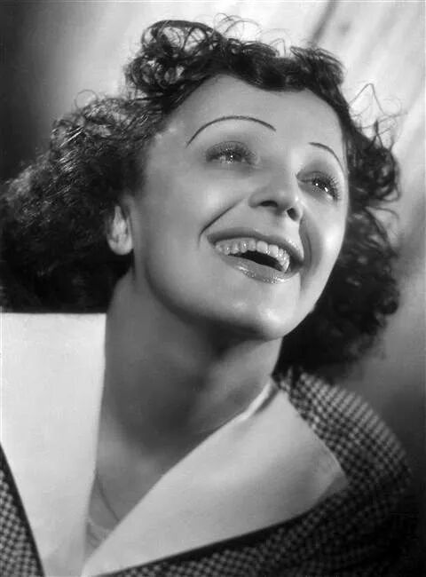
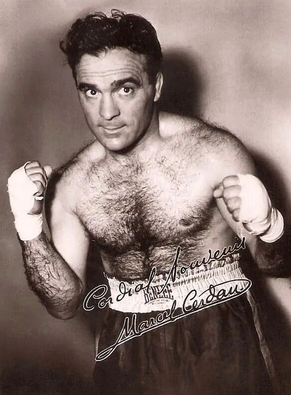
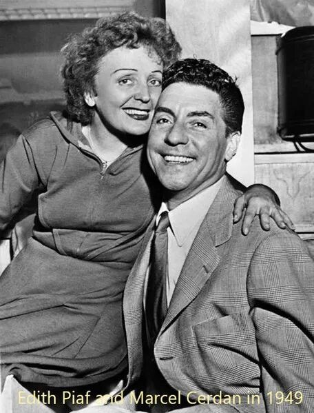
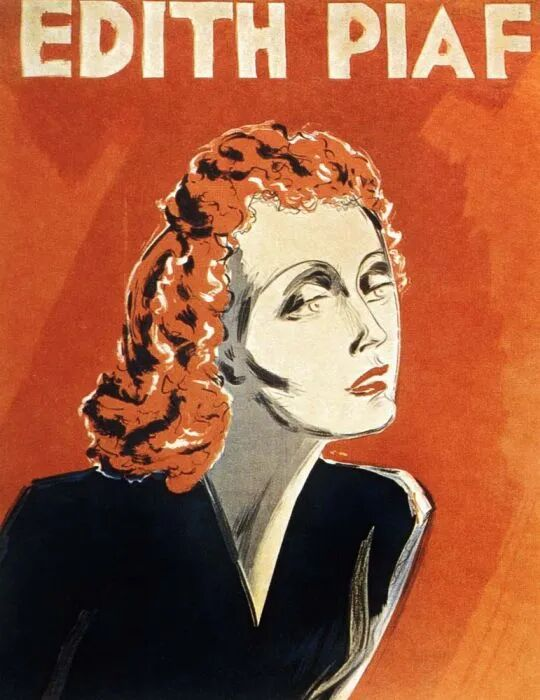
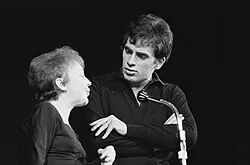
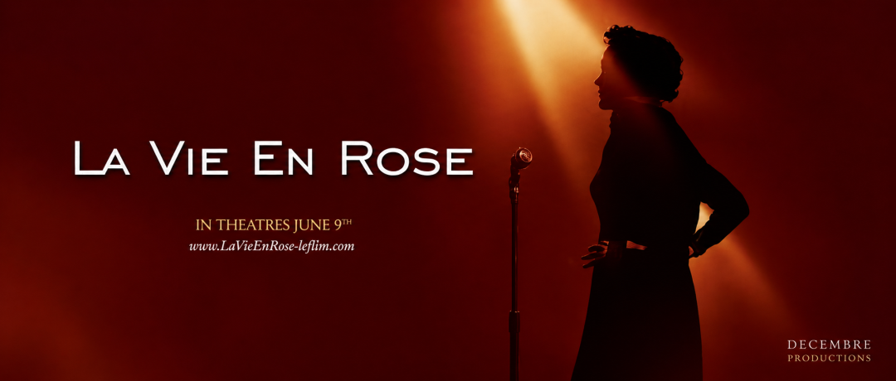

“Non! Rien de rien.

Non, je ne regrette rien…”

明亮的歌声响起，在人生的最后时刻，那个高歌“Non, je ne regrette rien”的女人，回首一生时，又真的如歌中那样坚定吗？

Édith Piaf对你来说也许是一个陌生的名字，但下面这几首歌，你或许有所耳闻：La Foule, Non, je ne regrette rien, La Vie en rose... 上周在法语课上，她的歌声响起时，我仿佛被什么击中了。那种声音绝非来自后天的训练与传承，而是上天赐予的礼物。

而这份仿佛来自天堂的歌声，却诞生在一个近乎破碎的童年里。

Édith Piaf 原名Edith Giovanna Gassion，出生于法国巴黎的美丽城，Belleville。她的父亲Louis-Alphonse Gassion是一名街头杂技演员，母亲Annetta Giovanna Maillard 则是一位咖啡馆歌手，具有当时被视作下等法国人的血统。她一出生便遭母亲遗弃，她只好由外祖母照顾。后来，父亲从军归来，将她带走，交由在诺曼底经营妓院的祖母抚养。

就这样，Édith Piaf在妓院中长大。听起来荒诞，甚至有些残酷，但妓女们将她视作己出。幼时的她曾患上严重的角膜炎，一度失明。在妓女们拼凑出钱陪她一同向圣女特蕾莎祈祷，最后，小Édith竟奇迹般恢复了视力。也许从那时起，命运就已经在她身上写下了一种矛盾那高昂而富有穿透力的歌声背后，竟是一片黑暗的人生深谷。

后来，Édith跟随父亲在街头卖艺。她没有真正意义上的舞台，街道就是她最早的剧场，路人就是她最早的观众。她跟着父亲踏遍法国。那些日子里，她并没有接受过系统的音乐训练，也没有人认真教她如何成为一名歌手。她只是站在人群面前，用声音换来生存的机会。

15岁，Édith Piaf离开父亲，独自谋生。就在那时她结识了一生的好友Simone "Mômone" Berteaut，两人总是结伴在街头演出。后来，Berteaut在自传中自称Edith的亲生姐妹。16岁的时候她爱上了一个名为Louis Dupont的送报员。在18岁时生下了她唯一一个孩子Marcelle，Marcelle在两岁时死于脑膜炎。巧合的是，Louis也是她父亲的名字，而她的人生，还会被“Marcel”这个名字深深影响。

命运的真正改变，是在她被夜总会老板 Louis Leplée 发现之后。Leplée 第一次听到她唱歌时，很快被她的声音打动。他把她带上舞台，也给了她一个艺名：“La Mome Piaf”，在法语中，Piaf意思是“小麻雀”，而Mome，则是“小家伙”。Édith的身高仅仅142厘米，而那小小身躯中的歌声令人不可置信，响彻法国。

从街头到夜总会，从无人知晓到被巴黎记住，Édith Piaf的人生像是突然被推向光亮处。可是这种光亮并没有立刻带来安稳。Louis Leplée 后来遇害，凶手是和Piaf曾经有联系的一群黑帮分子。她一度被卷入舆论和怀疑之中，事业也因此受到打击。她好不容易走上舞台，却又很快被命运拉回阴影里。

可她没有就此消失。在Raymond Asso，一个作词家的帮助和训练下，她重新整理自己的演唱方式，也重新出现在观众面前。而她和Raymond Asso也生出了师生以外的联结。也是此时，Raymond Asso给了她新的艺名，“Édith Piaf”即将响彻法国。这一次，她不再只是街头的小麻雀，而逐渐成为法国香颂中不可忽视的名字。

她的成名并不是一瞬间完成的。那更像是一场漫长的搏斗。贫穷的童年、街头的记忆、爱情的伤口，都在她的歌声里。1945年，由Piaf作词的La Vie en rose横空出世，直到今天传唱度仍极高。这首歌听起来浪漫，仿佛世界真的可以被爱染成玫瑰色。一个常见的误解是，La Vie en rose是Piaf为Marcel所作；但其实，那个成为她挚爱的人，此时还没出现。

她的名字Édith，本是纪念第一次世界大战中，因为帮助法国士兵逃离德国战俘营而被处死的英国护士，Edith Cavell。讽刺的是，第二次世界大战期间，Édith Piaf经常替德国军人演唱，因此被许多人视为叛国贼。后来艾迪特·皮雅芙宣称自己实际上支持法国抵抗运动。在二战结束后，Piaf开启了世界各地的巡回演出生涯。1947年，她首次前往美国，并在那里结识了在美国谋生的法国拳击手Marcel Cerdan，一段炽烈的感情由此展开。

Marcel Cerdan当时已是中量级世界拳击冠军，而Édith Piaf则是舞台上炙手可热的歌手。两个同样站在聚光灯下的人相爱，听起来像传奇，可这段感情并不只是浪漫故事。Marcel是有妇之夫，还有三个孩子；Piaf一度想让Marcel离婚，可Marcel拒绝了。而Marcel的妻子，自始至终都知道并默许Piaf的存在。

这段爱情最终以极其残酷的方式结束。1949年，Marcel Cerdan乘坐的航班不幸坠毁。而这个消息几乎击垮了Piaf。她曾经从童年的遗弃中活下来，从贫穷的街头走出来，也从事业的低谷中重新站起来，可爱人的突然离去，仍然在她心里留下了无法弥合的裂缝。后来她唱Hymne à l’amour时，很多人都觉得，那已经不只是一首情歌，而像是一封写给亡者的信。她把不能再说出口的话，把来不及完成的拥抱，把失去之后仍然燃烧的爱，全部交给了歌声。

1952年,Piaf与Jacques Pills结婚。这段婚姻维持到 1957 年。对她而言，这段婚姻像是巨大创伤之后，试图回到正常生活的一次尝试。Jacques Pills也是当时有名的歌手，他们或许能在事业和表演上互相理解。但问题在于，Piaf的人生从来不是稳定的。她的身体状况、情绪波动，以及她不断燃烧自己的生活方式，都让亲密关系很难真正安定下来。

所以这段婚姻最后走向离婚，并不太令人意外。

成名之后的Édith Piaf，拥有掌声、鲜花和无数观众，但她并没有真正远离痛苦。她长期受到疾病折磨，也经历过多次严重车祸。其中几次车祸给她留下了持续的疼痛。为了缓解这种疼痛，她开始使用吗啡一类的止痛药。最初，那也许只是为了让自己能够继续站上舞台，继续演出，继续唱歌。可是后来，药物不再只是止痛的工具，而慢慢变成了她无法摆脱的依赖。她的身体越来越虚弱，精神也越来越不稳定。酒精和药物交织在一起，让她的人生变得更加失控。

在她晚年，Théo Sarapo出现在她的生命中。他比Piaf年轻20岁，最初只是个一文不名的年轻歌手。他们的关系曾经受到很多质疑。1962年，Piaf与他结婚。有人认为这段婚姻太突然，也有人怀疑Théo Sarapo是否只是借助 Piaf 的名气。毕竟那时的 Piaf 已经疾病缠身，身体衰弱，而 Théo Sarapo 却年轻、英俊，人生似乎才刚刚开始。仅仅一年后，Piaf离世，所有人都以为Théo Sarapo坐享了Piaf的丰厚遗产。然而意料之外是，Piaf多年放浪形骸的生活，不仅没有留下遗产，还留下了一大笔债务。而Théo Sarapo在她去世后的几年，只是默默偿还这这些债务，直到1970年他也因车祸离世。死后，Théo Sarapo也被葬在拉雪兹神父公墓。

如果只把这段关系看成流言里的故事，也许又太简单了。对晚年的 Piaf 来说，Théo Sarapo 不只是一个年轻的丈夫，更像是她在生命最后阶段抓住的一点温度。她帮助他进入歌坛，与他一起演唱À quoi ça sert l’amour?意思是：“爱情有什么用？”

这个问题放在 Piaf 的一生里，几乎像一句命运的反问。她一生被爱情伤害，也一生不断追逐爱情；她失去过 Marcel Cerdan，也经历过许多破碎的关系，可到了最后，她仍然没有放弃去爱。成名之后的 Piaf 并不是从苦难中彻底逃了出来。她只是从街头走向了舞台，从贫穷走向了掌声，却依然没有摆脱疾病、成瘾、失去和孤独。

1960年，Piaf发表Non, je ne regrette rien。1963年，仅仅47岁的Piaf 因为肝癌死于法国的蔚蓝海岸Côte d'Azur。她的遗言是“Every damn thing you do in this life, you have to pay for.”。她最终与女儿一起葬于拉雪兹神父公墓中。虽然天主教巴黎总教区因她的生平拒绝为她举行安魂弥撒，她的葬礼还是吸引超过100000名歌迷参加。

也正因为如此，Non, je ne regrette rien不是豪言壮语，也不是圆满总结。相反，它是一个几乎被命运反复击倒的人，在最后仍然选择站起来的心气。

Non! Rien de rien

不，我一点都不后悔

Non, je ne regrette rien

不，没什么

Ni le bien qu'on m'a fait

无论人们对我好

Ni le mal tout ça m'est bien égal !

或对我坏，对我来说全都一样

Non ! Rien de rien ...

不，没什么

Non ! Je ne regrette rien...

不，我一点都不后悔

C'est payé, balayé, oublié

已付出代价了、一扫而空了、遗忘了

Je me fous du passé!

我不在乎它的逝去

Avec mes souvenirs

对於过去的回忆

J'ai allumé le feu

我付之一炬

Mes chagrins, mes plaisirs

我的忧愁，我的欢乐

Je n'ai plus besoin d'eux !

我再也不需要它们

Balayés les amours

扫却那些爱恋

Et tous leurs trémolos

以及那些颤抖的余音

Balayés pour toujours

永远地清除

Je repars à zéro ...

我要从零开始

