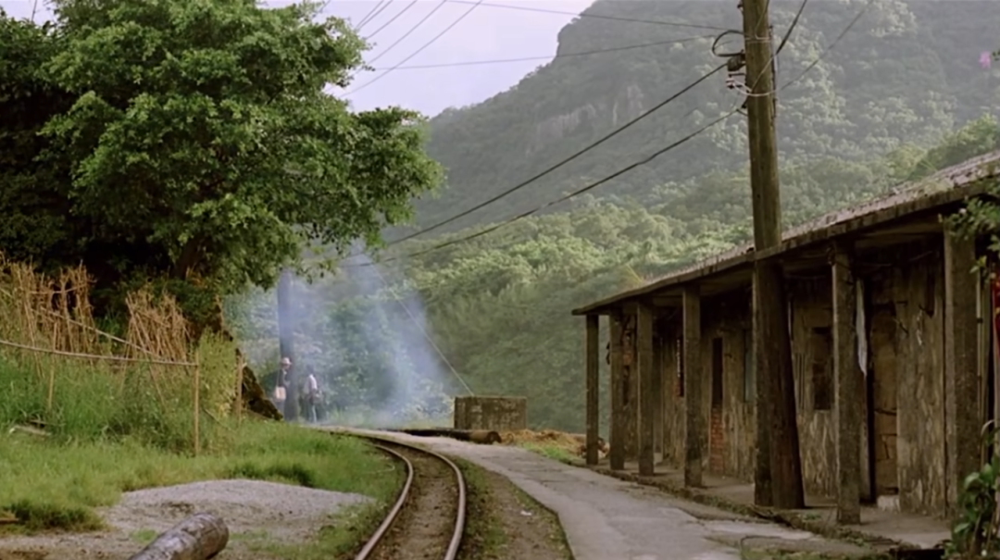
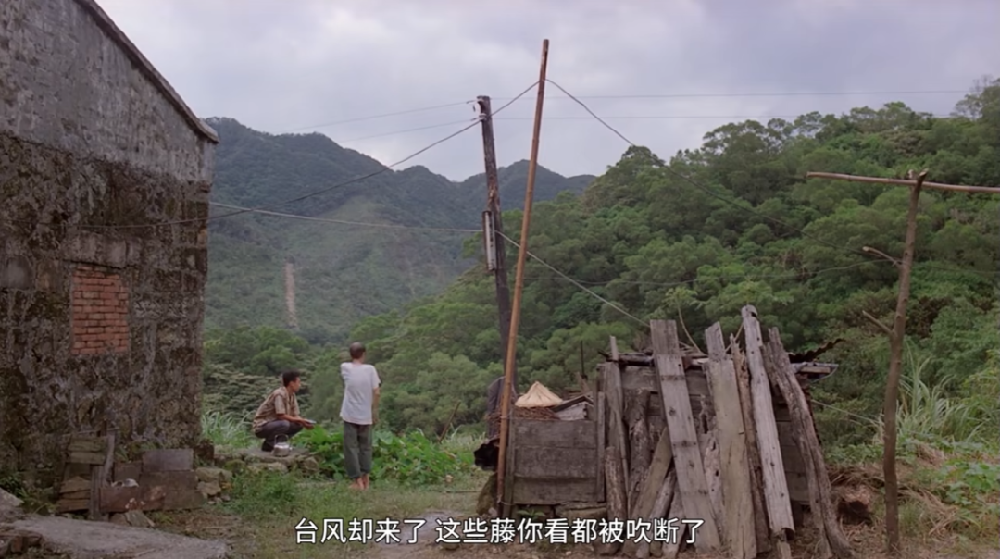
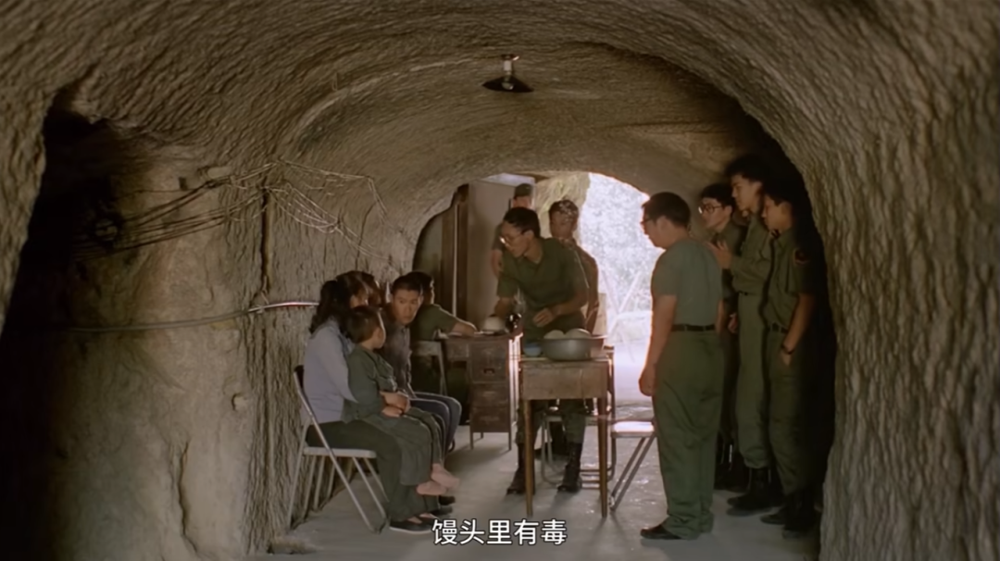
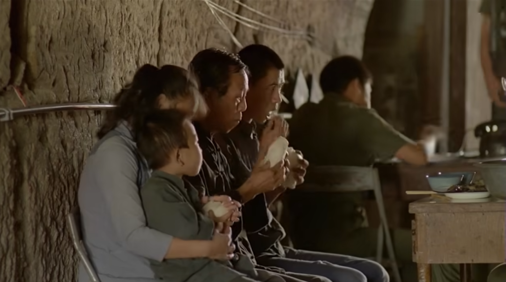

《恋恋风尘》是侯孝贤导演1986年的作品。直到今天，即使作为一个生在长在大城市的孩子，那些土路，那些风尘，那一抹深绿，仍然让我止不住流泪。

更难想象的是，几乎同一时期，杨德昌刚完成处女作《海滩的一天》，正在拍《青梅竹马》。而其中的台北景象，声色犬马，跟这青山似乎毫无关联。

同一个岛屿，又好像在两个世界。台北对两种人展现两种面孔。乡下人，美国回来的人，都是台北的外人，而台北又因经济发展变得陌生。山里的人和城里的人，好像做着不同的梦。一边是外国人口中要成为世界中心的台北，一边是乡下人要离开找活路的故乡。

最后好像谁也不属于台北。而这梦在别处延续。

相比杨德昌，侯导太克制，某种层面也衬托得杨导太说教。侯孝贤什么也不说，他让你自己去看——要说的反而给了配角。在《东东的假期》中，这个角色给了疯女人；而《恋恋风尘》中，爷爷则是当之无愧的话痨王。

番薯还是高丽参，不是作为人能决定的。台风来了，明知番薯收成不会好，还是要流汗，还是要除藤，还是要等那番薯生长。

其他的，侯导没说什么了。其他两个若有若无的无关痛痒的感想，不妨写下来作今后笑谈：

1. 谈感情别谈钱，特别是当作家人一样提供日常经济支持。太像亲人，反而成不了情侣；
2. 电影中，阿远和邮差都在金门服役。

语言上，其实没有不通；个人只像那迷航的渔船，哪懂海上风浪。

其他的，不多说了。