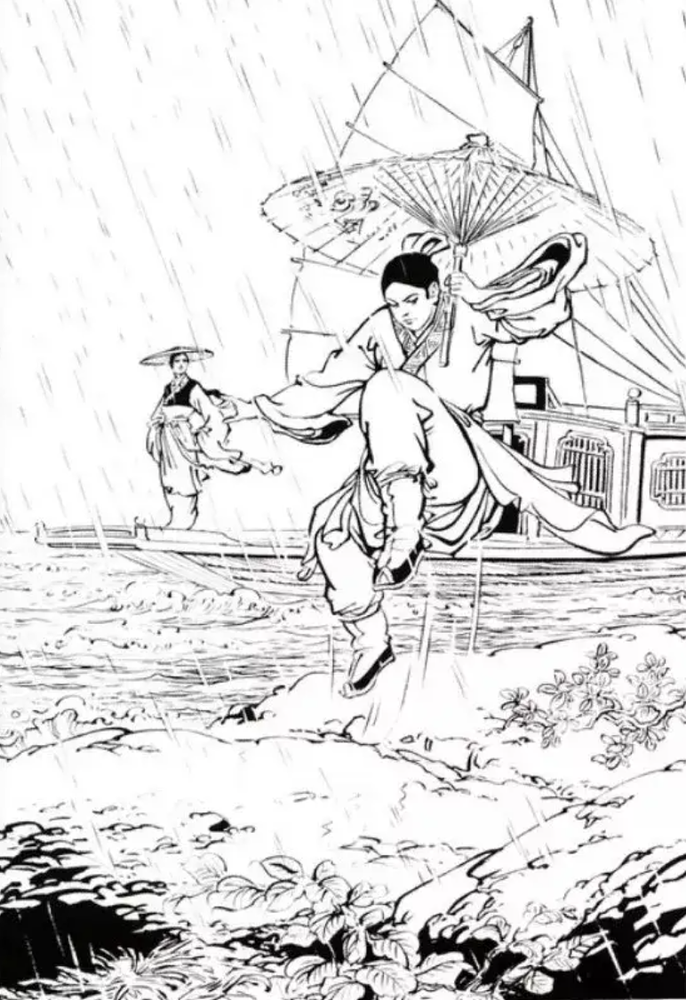
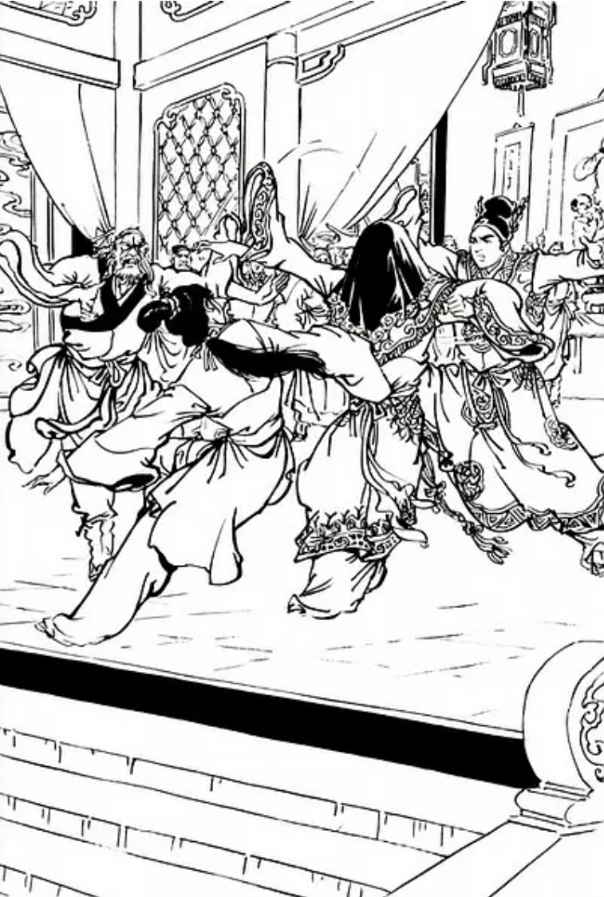
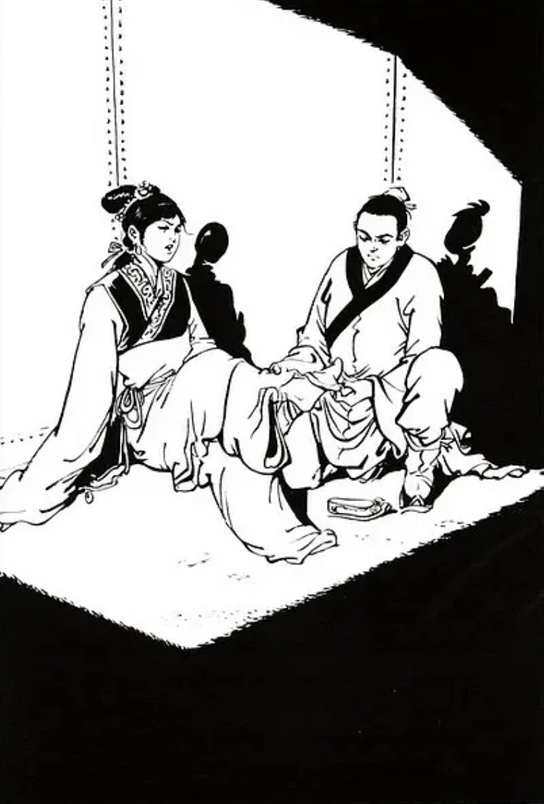
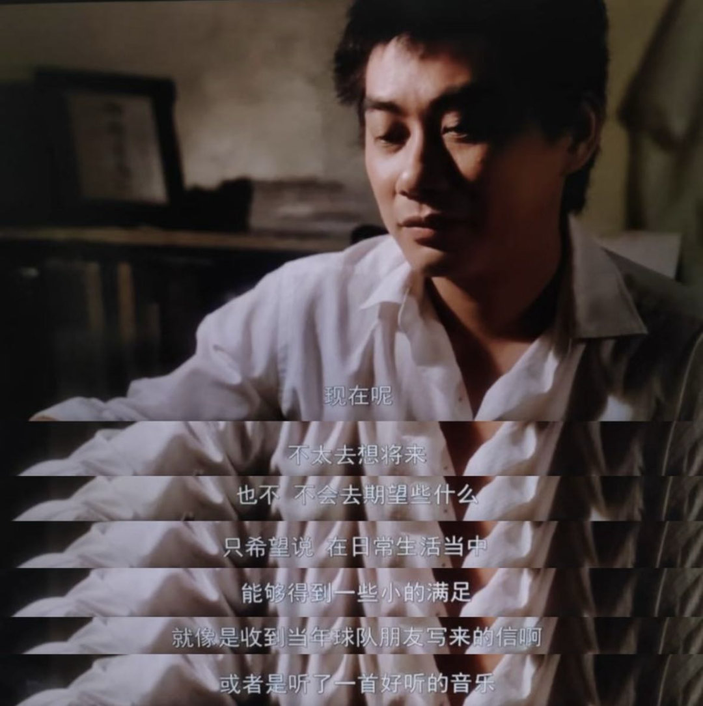

高中时，曾沉迷于金庸的武侠世界。“飞雪连天射白鹿，笑书神侠倚碧鸳”，我是初中就晓得的；那时候金庸老爷子去世，班主任让我们一笔一划写在笔记本上的，可惜那时候不懂。直到高中，才飞一般的读了其中前十二部，只剩押尾两部《碧血剑》和《鸳鸯刀》没读；直至今日，这仅剩的进度我还是没有补上。侠客的年代，毕竟是远去了。

如果让我来评，我最爱的几部是《连城诀》《雪山飞狐》和《倚天屠龙记》。我心目中的侠义的代表，不是郭靖，不是杨过，而是张无忌。这太让人奇怪了；也许我在张无忌身上看到了自己的影子，那样的犹豫，软弱，那样的希望退隐江湖。周芷若不能理解张无忌逃也般的推脱明教教主之位，恐怕生活中大多数人也是的。万人之上的地位，好像天生对于人就有致命的吸引力。相反之下，隐士反而成了怪胎，成了志向求而不得的牺牲品。这其中，是一种类似于阿Q的逻辑。

然而我并不是张无忌，我没有绝世的武功，一流的人品，没有调停世界的能力，逃离自然会被以为是种无能的回避。也没有人会放弃他的一切，只为了和我“做夫妻，养娃娃”。想来也是，这几年没有再看武侠小说，也许是明白了，自己充其量只是小说里的张三李四哩。

金庸笔下那么多女角色，让我记忆尤深的，只有一个赵敏。她的存在，好像就是用来和那些三从四德、讲究含蓄的良家妇女做对比的。“我偏要勉强”，这是不符合中国人价值观的，更是不符合传统社会对女人德行的要求的（虽然赵敏不是汉人）。年轻的金庸很仁慈，最后，让她得到自己想要的。

一直有一个很有意思的问题：王子和公主在一起，帷幕落下，幸福的大结局后，还会发生些什么？当然如同《倚天》新修版结尾一般，“做夫妻，养娃娃”了。让很多人不解的是，金庸在新修版结局让周芷若说了这样一句话：“你们尽管做夫妻、生娃娃，过得十年八年，你心里就只会想着我，就只不舍得我，这就够了。”看到这句，只管会心一笑——这是高中时的我永远不会懂的。

很多人说，这是一个红玫瑰白玫瑰的问题：“娶了红玫瑰，久而久之，红的变了墙上的一抹蚊子血，白的还是‘床前明月光’；娶了白玫瑰，白的便是衣服上沾的一粒饭黏子，红的却是心口上一颗硃砂痣。”在我看来，这不完全对。当我们回忆起青春中站着的那个人，和后来的有缘无份，我们想着的，是宁愿没有喜欢过吗？还是宁愿喜欢的是现在身旁这个跟你柴米油盐的人？那样就真的不遗憾了么。就我个人而言，或许还是留着些美丽的回忆好些。甚至也不是想回到过去，那么美好的回忆，也只是因为它在永远不再回的过去。

私以为，人生的自由在于可能性。十几岁二十岁的时候，觉得自己上天入地无所不能，狂傲不可一世。后来渐渐认识到有些事，不行就是不行；曾经和你站在一起的，不代表现在仍和你在同一水平上。做夫妻、养娃娃，千篇一律的脸，日复一日的工作，从某一天开始生活就像梦一样过。有一天猛然惊醒，那个自视甚高的少年，早就是谁的爸爸妈妈，谁的妻子丈夫。以为会和父辈不一样，最终还是成了谁的父辈。

值得庆幸的是，不自由不等于不快乐。意识到身处轮回中不代表一定要跳出轮回。这让我不由得想到杨德昌导演的处女作《海滩的一天》，这个下次再写。

