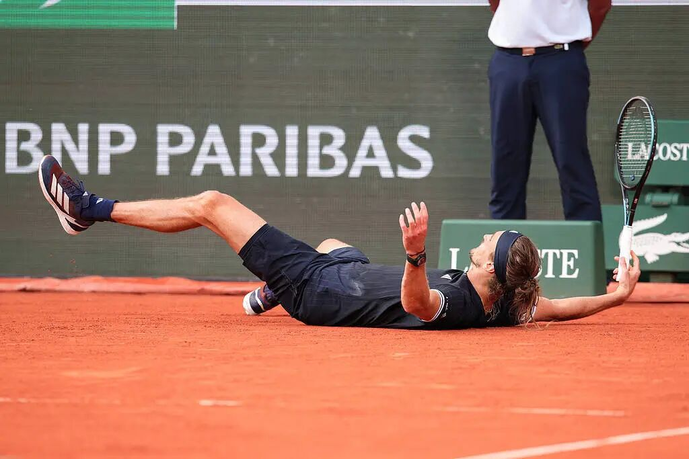
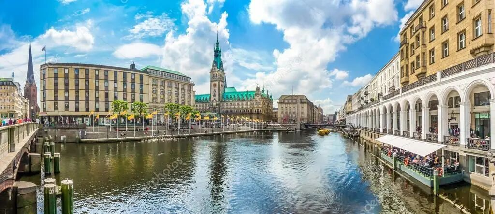
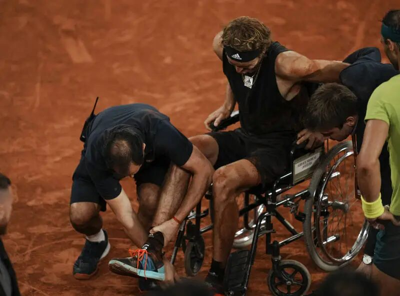
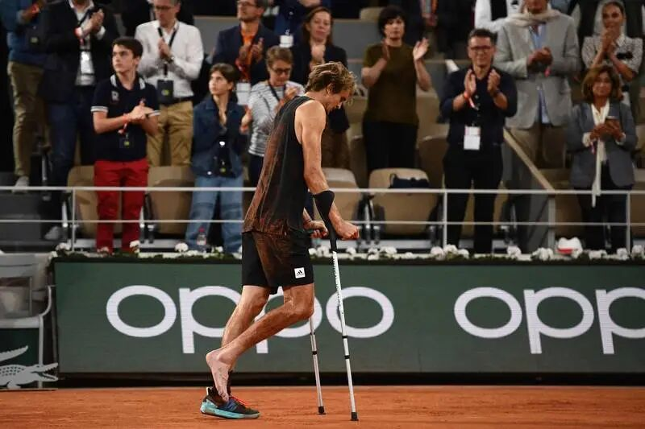
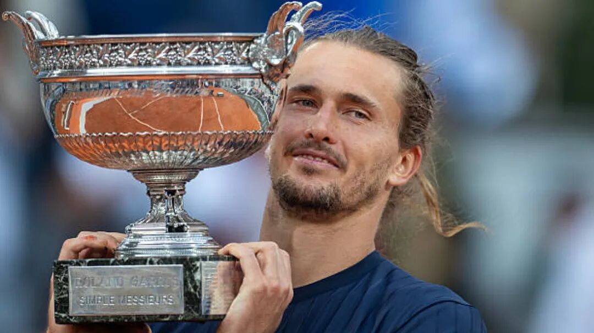

## 一、巴黎之夜

2026年6月7日，著名的罗兰·加洛斯球场上红土飞扬，巴黎的暑热在褪去。从下午3点一直到傍晚，四个多小时的苦战，一场五盘大战正式谢幕。

亚历山大·兹维列夫平躺在这片给他带来过无数伤痛的红土上，双手捂住了脸。

他的肩膀在颤抖，不是因为疲惫——尽管五盘大战早已把他的体能推到了极限——而是因为某种比疲惫更深、比疼痛更久的东西，终于在这一刻决堤了。那些东西积压了太久，久到他自己都不确定它们是否还在。

法国网球公开赛，男单决赛，冠军。

法网真不是时候，正撞上高考，正撞上期末周。我在繁忙的学期末腾出一个夜晚，本是想看另一个选手——辛纳是如何实现全满贯的。包括我在内的所有人，都觉得辛纳拿法网是板上钉钉。在此之前，辛纳拿下了26年红土赛季的所有大师赛冠军，上一个也是唯一一个拿下这个成就的，是纳达尔；在家门口的罗马大师赛，他不仅把冠军留在意大利，还打破了德约大师赛31连胜的壮举——34连胜，24岁的年龄，4座大满贯，辛纳只差一个法网，而阿尔卡拉斯的伤退，让他在这个赛季的表现几乎坚不可摧。

意料之外的是，辛纳在仅仅第二轮就出局，先以2：0横扫对手，再2：3干脆地输掉比赛。而别的夺冠热门，梅德韦杰夫一轮游，德约2：3新星丰塞卡，门希克倒是站在了兹维列夫的对面，但还是输掉了比赛。这是个千载难逢的机会，“最强第三人”，“千年老二”兹维列夫，比任何时候都接近大满贯。

而我一直对兹维列夫喜欢不起来。打球时，他是个软蛋，通过磨球等待对手失误；生活上，他被两个前女友公开指控实施暴力。决赛时，我希望科博利夺冠，即使他连大师赛冠军都没拿过。

然而兹维列夫很幸运，终于也把握住了一次机会。即使场上他发出了数不清的双误——甚至有的时候连送两个双误，他还是赢了。

从他第一次以职业球员的身份踏上球场，到他终于在巴黎险夺大满贯，中间隔了4510天。

兹维列夫站起来的时候，眼眶是红的。

## 二、汉堡的孩子

要理解兹维列夫，必须先理解汉堡。

不是那个因港口贸易和披头四早期演出而闻名的德国第二大城市，而是他生长的那栋房子里的空气。1997年4月20日，亚历山大·"萨沙"·兹维列夫出生在汉堡，但他的血液里流淌着另一个世界。

他的父亲，老亚历山大·兹维列夫，1960年出生于苏联时期的索契。母亲伊琳娜·兹维列娃，同样来自苏联，曾是职业网球运动员。他们是在球场上相识的——不是罗德·拉沃尔那种球场，而是苏联体育体制下那种冰冷的、功利的、把运动员当作国家资产来培养的球场。

老兹维列夫一家在苏联解体前后来到德国。他们是"那一代人"——在柏林墙倒塌的尘埃中寻找新生活的前苏联移民。他们带着浓重的口音、对体制的不信任、和无数质疑的眼光。

这个信念最终具象化为两块网球拍。

萨沙的哥哥米沙·兹维列夫比他大十岁，1987年出生。米沙先走上了职业网球的道路，后来成为了一位有相当水准的巡回赛选手，最高排名曾进入前三十。

老兹维列夫是两个儿子的教练。这是个至关重要的事实，因为父亲既是技术的塑造者，也是压力的传导者。在很多关于萨沙·兹维列夫的采访中，你能隐约听到一个被反复提及的词：严厉。不是西方式的"严格要求"，而是带着某种东欧特有的、近乎苦行僧式的、把汗水和眼泪都视为学费的严厉。

汉堡的冬天漫长而灰暗，网球训练馆里的日光灯管发出嗡嗡的声响。小萨沙在发球线后面一次又一次地抛球、挥拍，直到手臂酸得抬不起来。父亲站在球网对面，面无表情地捡球、喂球，偶尔用俄语说一两句简短的指令。没有拥抱，没有"你真棒"，有的只是对下一个动作的要求。
我不知道这算不算一种创伤。也许在老兹维列夫看来，这是通往卓越的唯一道路——他自己就是这么走过来的，在苏联的训练营里，在冰天雪地中，在没有人会夸奖你的体制里。但每个被严厉教育过的孩子都会在心里留下某种空洞。那种空洞不是爱的缺失，而是一种"永远不够好"的预感。

兹维列夫一家住在汉堡郊区，周围不是网球俱乐部，而是普通的居民区。萨沙的童年不是被隔离在精英体育的温室里的。他上学，和邻居的孩子玩耍，在街头踢足球。这些看似平凡的经历，后来在他身上留下了一种奇特的混合气质——他既是一个被网球塑造的精密机器，又保留着某种街头少年的粗粝和率性。这种混合让他的性格充满了张力：他可以在赛后发布会上说出极不得体的话，也可以在球童摔倒时第一个冲过去扶。
但这些都是后来的事了。2014年之前，他只是汉堡的一个网球少年，世界对他来说，还只是一块球场那么大。

## 三、破土

2014年，亚历山大·兹维列夫十七岁。

在网球世界里，十七岁是一个暧昧的年纪。太年轻，不能被当作真正的职业选手看待；太老了，不能再被称为神童。这个年纪的球员通常在青少年赛事和低级别的挑战赛之间徘徊，偶尔获得一张正赛外卡，然后在第一轮或第二轮被淘汰，然后回到训练场，继续等。

兹维列夫没有等。

2014年的汉堡公开赛，他以外卡身份参赛。这座他生长的城市，成了他职业生涯的起点。他在首轮击败了当时排名远高于自己的对手，然后在第二轮打满了三盘，最终惜败。十七岁的他站在球场中央，向主场观众致意，脸上是少年人特有的、混合着兴奋和不安的表情。

那年稍后，他在柏林的一场挑战赛中夺冠，成为最年轻的挑战赛冠军之一。巡回赛的门，就这样在他面前打开了。

2015年和2016年是他的快速成长期。他的排名像温度计一样一路上升，从三百开外一路飙升到前五十。他开始在ATP巡回赛中赢得比赛——不是侥幸的一两场，而是系统性的、令人信服的胜利。2016年，他在圣彼得堡赢得了个人第一个ATP巡回赛冠军，同年还进入了上海大师赛的决赛。
网球界开始为他寻找标签。"下一个大满贯冠军"是最常见的说法，但这个标签贴在每一个成绩突出的年轻球员身上，早已贬值到近乎无意义。真正让专家们侧目的，是他的打法所暗示的上限。

兹维列夫身高一米九八，发球时速经常超过220公里，正手击球的力量大到能让对手的球拍震动。但他不是一个只会蛮力的巨人。他的移动能力在同身高的球员中极为罕见——你很少看到两米左右的球员能在底线做出那种快速的横向滑步和突然的变向。他的双手反拍稳定而精准，被很多分析师认为是当代网球中最好的反手之一。

2017年罗马大师赛，二十岁的兹维列夫在决赛中击败了德约科维奇，赢得了他的第一个大师赛冠军。这是他职业生涯的分水岭。从那天起，"下一个大满贯冠军"不再只是一个标签，而变成了一种几乎必然的预言。

但预言和现实之间，往往隔着一条看不见的河流。而兹维列夫，将在那条河里挣扎很多年。

## 四、巨人的阴影

要理解兹维列夫为什么花了4510天才赢得他的第一个大满贯，你必须理解他所处的时代。

从2003年费德勒赢得第一个温网冠军开始，到2023年德约科维奇赢得他第二十四个大满贯，整整二十年，男子网坛被三个名字统治着：罗杰·费德勒、拉斐尔·纳达尔、诺瓦克·德约科维奇。三人合计赢得了六十六个大满贯单打冠军。这个数字是疯狂的。在他们之前，没有哪个时代有过这样的垄断；在他们之后，也许也不会再有。

兹维列夫的成长，恰恰发生在这三位巨人的统治末期。

这不是一个容易的位置。想象一下，你是一个年轻的钢琴家，生在贝多芬、莫扎特和巴赫同时活着的时代。你可以弹得和他们一样好，甚至在某些技术指标上超过他们，但你永远无法摆脱一个事实：他们是定义者，而你是被定义者。

兹维列夫在大满贯赛场上遇到的，几乎总是这三个人中的某一个，或者他们的影子。2017年澳网第三轮，他输给了纳达尔。2018年法网四分之一决赛，他输给了蒂姆，而蒂姆又在半决赛中输给了纳达尔。2019年法网四分之一决赛，他再次输给德约科维奇。每一次他走到大满贯的深处，总有一面墙挡在面前。

但真正让兹维列夫的故事变得复杂的，不是他输给巨头——毕竟，所有人都输给巨头——而是他在那些不该输的比赛中展现出的脆弱。

2018年，兹维列夫赢得了ATP年终总决赛的冠军，在决赛中直落两盘击败了德约科维奇。那场比赛中，他的表现堪称完美——发球精准、底线犀利、关键时刻毫不手软。赛后，连一向不轻易夸人的德约科维奇都说："他今天的表现证明了他属于最顶级的行列。"

然而，同样是这个兹维列夫，一个月后在澳网第四轮输给了排名远低于自己的米尔曼。两周后在印第安维尔斯大师赛首轮出局。三个月后在迈阿密大师赛第三轮被淘汰。

这种反差令人困惑。一个能在年终总决赛中击败德约科维奇的球员，怎么会在同一赛季的一系列比赛中表现得判若两人？

答案也许在于网球这项运动最残酷的特质：它不只是关于实力，更是关于在正确的时间把实力发挥出来的能力。 大满贯赛事是两周的马拉松，需要在七场比赛中持续保持巅峰状态。任何一个环节的松懈——体能、心理、战术、甚至运气——都可能导致出局。而兹维列夫的问题，恰恰出在了那个最难以量化、也最难以修复的环节上。

心理。

或者更准确地说，是在关键时刻的心理稳定性。

兹维列夫不是那种在大场面中会怯场的球员。相反，他在表演赛和低级别赛事中表现出的那种自信和松弛，有时候甚至让人觉得他过于放松了。但在大满贯的五盘三胜制中，当比分胶着、当身体疲劳、当对手开始反击时，他有时候会突然"断电"。那种断电不是技术层面的——他的发球速度没有下降，他的击球力量没有减弱——而是决策层面的。他会开始做一些不合常理的选择：在不该上网的时候上网，在应该保守的时候冒险，在需要耐心的时候急于求成。

他是那种让你相信他可以赢得一切的球员，也是那种让你在最相信他的时候被他伤到的球员。

这让我想起雷蒙德·卡佛的一句话："我们被我们所爱的东西塑造，也因我们所爱的东西受苦。"兹维列夫爱网球，也许比很多人都爱得更深——他的整个童年和青春都献给了这块球场。但恰恰是这种深度的投入，让他在失败时承受的打击也成倍放大。

一个只把网球当职业的球员，输了就输了，回家休息，下次再来。但兹维列夫不是。他的父亲是教练，他的哥哥是球员，他的整个家族的意义都建立在网球之上。当他输掉一场大满贯时，他不只是输了一场比赛，而是在某种意义上辜负了一个家族几代人，乃至一个国家球迷的期望。

这种重量，不是坐在解说席上的人能理解的。

## 五、法拉盛的午夜

2020年9月13日，纽约法拉盛草地公园，美国网球公开赛男单决赛。

这场决赛值得用整整一章来书写，因为它是兹维列夫职业生涯中最接近大满贯冠军的一次，也是他此后很长时间里最深的一道伤疤。

对手是多米尼克·蒂姆，一个同样被巨头阴影笼罩的同龄人。蒂姆比兹维列夫大四岁，同样是"90后"一代中最早被寄予厚望的球员。但与兹维列夫不同的是，蒂姆已经在大满贯决赛中经历过三次失败——两次法网输给纳达尔，一次澳网输给德约科维奇。蒂姆已经学会了如何在决赛中呼吸，即使那种呼吸仍然带着紧张。

那一年的美网是特殊的。因为新冠疫情，赛事在没有观众的情况下举行。法拉盛的阿瑟·阿什球场——这个能容纳两万三千人的世界上最大的网球馆——空空荡荡。球员的呼吸声、球鞋与硬地的摩擦声、击球时球拍与球碰撞的"砰"声，在空旷的球场中被无限放大。没有观众的欢呼来掩盖紧张，没有掌声来缓解压力。一切都被赤裸裸地暴露着。

兹维列夫开局完美。6-2，6-4，他连下两盘。在五盘三胜制的大满贯决赛中，以2-0领先几乎等同于一只脚已经踏上了冠军领奖台。统计数据显示，在美网历史上，男子决赛中2-0领先的球员，最终赢得冠军的概率超过百分之九十。

看台上没有观众，但全世界数以百万计的屏幕前，无数人已经开始为兹维列夫的首冠写好了剧本。

然后，剧本变了。

第三盘，蒂姆开始反击。那种反击不是暴风雨式的，而是渗水式的——一局一局、一分一分地侵蚀着兹维列夫的领先优势。兹维列夫的发球开始失去精度，他的正手开始多出几个失误，他在关键分上的决策开始变得……犹豫。

6-4，蒂姆扳回一盘。

第四盘，情况进一步恶化。兹维列夫在自己的发球局中显得越来越不自信。他的肢体语言泄露了一切——垂下的肩膀、频繁望向球员包厢的眼神、在失误后过长的停顿。蒂姆以6-3再下一盘。

2-2。决胜盘。

在空无一人的球场上，你能清楚地听到兹维列夫调整呼吸的声音。那种声音沉重而急促，像是一台发动机在过热状态下艰难运转。

决胜盘的比分咬得很紧。双方各自保发，一路来到抢七。在抢七中，兹维列夫一度以5-3领先，再拿两分就能赢得他人生中第一个大满贯冠军。
他没有拿到。

蒂姆连追两分，追至5-5。然后兹维列夫拿到一个冠军点——6-5。这个冠军点发生在他的发球分上，天时地利人和（虽然没有观众），一切条件都在他这边。

他发出了一个时速超过200公里的一发。蒂姆接发回球，浅了。兹维列夫面前是一片开阔的场地，他只需要把球打到任何没有人的地方。他选择了正手直线。

球出了界。

那一拍，你能听到球拍击球的声音，也能听到球落在底线外的细微声响，甚至能隐约听到球员包厢里某个人倒吸冷气的声音——尽管那里只有教练和少数工作人员。

比赛继续。蒂姆最终在抢七中以8-6获胜。

第五盘，蒂姆以6-4赢下。

整场比赛耗时四小时零一分钟。当最后一分结束时，兹维列夫弯腰撑在膝盖上，久久没有起身。蒂姆走向网前，两人拥抱。蒂姆在拥抱中对他说了些什么，兹维列夫点了点头。

赛后的颁奖典礼上，兹维列夫对着空无一人的球场说了一段话。他说得很慢，英语中夹杂着微微的德语口音，每个词都像是从嗓子眼里硬挤出来的："我很想感谢所有人……但我今天最想感谢的是我的家人。我知道他们此刻在电视机前。"他的声音在这里断了一下，"我想对我爸说……对不起。"

对不起。

不是"谢谢你"，不是"我下次会赢回来"，而是对不起。

这句话比任何失利都更让人心碎。在兹维列夫的内心深处，每一次失败都不只是个人的遗憾，而是一种对父亲的亏欠。那个在汉堡的训练馆里日复一日陪他练球的人，那个用严厉和沉默表达一切的人，那个把他培养成世界顶级球员的人——兹维列夫觉得自己欠他一个大满贯冠军。

2020年的那个夜晚，兹维列夫没有赢下那场比赛，但他输掉的远不止一场比赛。他输掉了对自己能力的某种确信，输掉了"也许这次就够了"的侥幸心理，也输掉了某种天真——那种认为只要足够努力，结果就一定不会辜负你的天真。

从法拉盛回酒店的车上，兹维列夫没有说话。多年后他在一次采访中回忆起那个夜晚，只说了一句："那是我第一次真正理解，网球不会因为你想要它，就给你。"

## 六、断裂

2022年6月3日，巴黎，罗兰·加洛斯，法网男单半决赛。

兹维列夫对阵纳达尔。

此时的纳达尔已经三十六岁，身体伤病缠身，双脚因穆勒-韦斯氏病而几乎每次移动都在承受剧痛。但在罗兰·加洛斯的红土场上，纳达尔永远是那个被命运眷顾的人。他在这里赢得了十三个冠军，从未在半决赛或决赛中输过。

兹维列夫却带着前所未有的状态来到巴黎。整个2022年的红土赛季，他的表现近乎完美。他在马德里大师赛中夺冠，在罗马大师赛中打入决赛，他的击球质量、移动能力和比赛中的专注度都达到了职业生涯的最高水平。很多人认为，这是他赢得法网的最佳时机——纳达尔老了，德约科维奇因为疫苗问题无法参加部分赛事，新生代的阿尔卡拉斯还太年轻。

半决赛第一盘，双方打到了抢七，纳达尔最终还是拿下了第一盘。比赛的节奏和质量都极高，两位球员在红土场上的对攻堪称年度最佳。

第二盘，比分再次胶着，再次来到6-6。兹维列夫在跑动中试图回球时，右脚踝发生严重扭伤。

他倒在地上，发出了撕心裂肺的喊叫。

那声喊叫后来在社交媒体上被反复播放了无数次。它不像球员在比赛中常见的喊叫——那种带有表演性质的、用来释放压力的声音——而是一种来自身体深处的、原始的、无法伪装的痛苦。如果你闭上眼睛只听声音，你会以为有人在经历酷刑。

兹维列夫被轮椅推出了球场。

后来的检查显示，他的右脚踝韧带撕裂，需要手术。赛季报销。

当他在球员通道中被推出去的时候，纳达尔站在底线附近，双手合十，脸上是那种你很少在竞技场上看到的表情——不是庆幸对手退赛，而是真正的、发自内心的同情。纳达尔太了解伤病了。他的整个职业生涯都在和身体的极限搏斗，他知道那种感觉：你的灵魂还在球场上，但你的身体已经不允许了。

兹维列夫坐着轮椅经过球员通道时，红土场上的阳光透过窗户照进来，在地面上画出一道道金色的条纹。他低着头，双手交叠在膝盖上，整个人像是被抽空了。

受伤对于职业网球运动员来说是家常便饭，但踝关节韧带撕裂不是普通的伤病。它不仅需要漫长的康复期，还会在心理上留下后遗症——每一次跑动、每一次变向、每一次起跳，都可能触发对再次受伤的恐惧。很多球员在类似的伤病后，再也无法恢复到受伤前的水平。

兹维列夫的康复过程持续了将近半年。在那段日子里，他经历了人生中最漫长的一段远离球场的时间。他无法训练，无法比赛，每天的生活被物理治疗和康复训练填满。他后来回忆说，那段时间他经常在半夜醒来，不是因为脚疼，而是因为一种无名的焦虑。

"你突然意识到，网球不只是你的职业，它是你的整个身份。当它被拿走的时候，你甚至不知道自己是谁了。"

当兹维列夫在2022年下半年躺在康复室里做物理治疗时，他不仅在和脚踝的伤病搏斗，还在和公众的审视搏斗，和那些永远无法完全洗清的指控搏斗，和一种"无论我做什么，总有人会看到我最坏的一面"的无力感搏斗。

## 七、漫长的归途

2023年初，兹维列夫复出了。

他的脚踝还没有完全恢复，移动时你能看出他的犹豫——不是技术层面的犹豫，而是身体本能层面的警惕。每一次他需要做大幅度的横向移动时，都会有一个几乎不可察觉的停顿，仿佛他的大脑在告诉他的脚踝："小心，别再伤了。"

这个停顿在慢镜头回放中特别明显。它只有零点几秒，但在网球这种以毫秒计算反应时间的运动中，零点几秒足以改变一切。

复出后的前几个月，他的成绩不尽如人意。他在一些早期轮次就被淘汰，对手不是什么名将，而是那些排名远低于他、本应被他轻松击败的球员。每一场失利都像是一次小型的身份危机。

他调整了自己的打法。受伤前，他是一个极度依赖移动和底线相持的球员，他会用不知疲倦的跑动来弥补偶尔的技术失误。受伤后，他必须学会用更少的移动来赢得更多的分数。这意味着他的发球必须更精准，他的击球选择必须更聪明，他必须在更短的时间内结束每一分。

这种调整，说起来容易，做起来却需要推翻十几年的肌肉记忆。2023年的兹维列夫，像一个正在学习新语言的人。他说得磕磕绊绊，偶尔还会冒出旧语言的口音，但你能看到他每天都在进步。

2024年，进步终于开花结果。他在一系列赛事中展现出了回归巅峰的迹象——他的发球再次成为武器，他的正手再次充满穿透力，最关键的是，他在关键分上的表现开始变得稳定。阴影似乎在逐渐消散。

2024年法网，他一路过关斩将，再次打入决赛。对手是卡洛斯·阿尔卡拉斯，二十岁的西班牙天才，已经拥有两个大满贯冠军，打法融合了纳达尔的斗志和费德勒的优雅。

决赛是一场五盘大战。兹维列夫先赢一盘，然后被阿尔卡拉斯连扳两盘，再赢回一盘将比分追至2-2。决胜盘中，阿尔卡拉斯展示了他为什么被认为是"下一个统治者"的全部理由——他的速度、他的创造力、他在压力下的从容。兹维列夫以2-6输掉了决胜盘。

又一次，他站在大满贯决赛的球场上，看着对手举起奖杯。

赛后发布会上，有记者问他："你觉得你还能赢得大满贯吗？"

兹维列夫沉默了很久，久到记者以为他不会回答了。然后他说："我不知道。但我不会停止尝试。"

## 八、4510天

让我们回到开头的数字。

4510天。从2014年2月他正式踏上职业巡回赛的那一天算起，到2026年6月7日他在巴黎捧起冠军奖杯，中间隔了4510天。

4510天里发生了什么？

他赢得了二十三个ATP巡回赛单打冠军，包括六个大师赛冠军和两个年终总决赛冠军。他在奥运会上为德国赢得了一枚金牌。他的最高世界排名达到第二位。他参加了超过七百场职业比赛，赢了其中五百多场。

他经历了至少三次重大伤病。他在大满贯决赛中输了两次。他在半决赛中因为脚踝撕裂被轮椅推走。他在康复室里度过了无数个痛苦的白天和失眠的夜晚。

他在公众面前哭过很多次——在2020年美网的颁奖典礼上，在2022年法网的球员通道里，在2024年法网的赛后发布会上。这些哭泣的画面在互联网上被反复传播、截图、配文、评论，有时候是同情，有时候是嘲讽，更多时候是那种居高临下的"分析"："他的心理素质不行。"

在今年法网，这个“软蛋”终于在几次挣扎后抓稳这来之不易的机会，决胜盘他很冷静。他离多年的期望就差一步。

6月7日，巴黎。菲利普·夏蒂埃球场。

兹维列夫走进球场时，我没有从他的脸上读到太多东西。不是因为他的表情管理有多好——他从来不是一个善于隐藏情绪的人——而是因为那种表情太复杂了，复杂到你无法用一两个词去定义。它不是紧张，不是兴奋，不是志在必得，也不是如临大敌。它更像是一个人站在一扇门前，门后面可能是他等了半辈子的东西，也可能又是空的，而他已经习惯了空的。

科博利显然更紧张。这是他的第一次大满贯决赛，面对的又是世界排名第三的兹维列夫。第一盘开局，兹维列夫就实现破发，取得2-0领先。科博利在第三局保发后，兹维列夫连下四局。科博利的非受迫性失误在第一盘就达到了十六次——不是因为兹维列夫的球有多刁钻，而是因为他自己的手在发抖。

39分钟，6-1。兹维列夫拿下首盘。

第二盘，科博利逐渐稳住了阵脚。他在第三局和第四局连续保发，开始敢于在底线与兹维列夫对拉。比分来到3-3。关键的第七局，兹维列夫的发球局，他出现了两次双发失误，破发点上正手拍失稳，科博利完成破发。兹维列夫转头看向球员包厢，对教练团比画了几下，脸上是明显的不满。

科博利趁势以6-4拿下第二盘。大比分1-1。

第三盘，双方各自保发，比分交替上升至4-4。兹维列夫在第九局保发后取得5-4领先。第十局是科博利非保不可的发球局，他在这一局一度以30-0领先，看起来保发在望。然后他连丢四分——兹维列夫逼出破发点并成功兑现，以6-4再下一城。大比分2-1。

第四盘的比赛进入了体能的"瓶颈期"。两人的移动都明显变慢，击球的深度和精度都在下降。科博利开局率先破发，兹维列夫在第六局完成回破，科博利再连赢两局取得5-3领先。然后兹维列夫调整状态，连下三局将比分追至6-6，比赛进入抢七。

抢七中，双方继续僵持。科博利在关键时刻上手，以7-5拿下抢七。大比分2-2。

又是一个决胜盘。又是在菲利普·夏蒂埃球场。

这个球场对兹维列夫来说承载了太多东西。2022年，就是在这片红土上，他的脚踝韧带撕裂，他被轮椅推离球场。2024年，就是在这片红土上，他在决赛的决胜盘中以2-6输给了阿尔卡拉斯。此刻，他又站在了同一个地方，面对又一个决胜盘。

但这一次，兹维列夫没有犹豫。

决胜盘第一局，他完成破发。第三局，再次破发。比分迅速拉开到4-0。科博利的体能已经明显下降，情绪也出现了起伏。第五局科博利直落四分保发，让人看到一丝翻盘的希望，但那只是昙花一现。

6-1。决胜盘锁定。

全场比赛耗时四小时十六分钟，五盘大战，兹维列夫以6-1、4-6、6-4、6-7(5)、6-1的比分击败科博利。

当科博利在第二个冠军点上高压扣杀出界时，兹维列夫倒在了红土上。

虽然没能带来一场精彩的决赛，但是正如法网的口号一样，Victory belongs to the most tenacious。用法语说，是La victoire appartient au plus opiniâtre。

胜利属于最顽强的人。

## 九、最弱大满贯？

在兹维列夫赢得澳网冠军后的几天里，互联网上出现了一种声音——一种其实早就预料到的声音：

"这是近年来最弱的大满贯冠军。"

持这种观点的人有他们的逻辑。他们的论证大致如下：兹维列夫赢得的这个冠军，发生在"巨头时代"彻底终结之后。费德勒和纳达尔已经退役，德约科维奇虽然仍在参赛，但三十七岁的他已经不再是那个曾经统治一切的德约科维奇。新生代中，阿尔卡拉斯伤退，辛纳意外出局。兹维列夫是在一个"权力真空期"拿到了他的第一个大满贯——不像蒂姆在2020年美网击败了他，不像阿尔卡拉斯在2022年美网击败了鲁德和卡恰诺夫，不像辛纳在2024年澳网击败了梅德韦杰夫。

因为"最弱大满贯"这个说法之所以有市场，不仅仅是因为对手的强弱，更是因为它触及了一个更深层的、关于体育叙事的本质：人们喜欢看的是英雄从巅峰陨落，或者天才横空出世，而不是一个人花了4510天终于爬到了山顶。

兹维列夫的故事不符合传统的英雄叙事。他不是一个在关键时刻总是力挽狂澜的超级英雄，也不是一个在沉默中积蓄力量然后一鸣惊人的隐士。他是一个充满矛盾的、有明显缺陷的、有时候让你想关掉电视的人。他在2020年美网决赛中2-0领先然后输掉了。他在2022年法网半决赛中因为自己的失误导致了伤病。他在职业生涯的关键节点上多次掉链子。他有场外的争议。他总是在发布会上说不得体的话。

恰恰是这些"缺陷"，让他的故事不精彩，不够引人注目，但是真实。

## 十、他的父亲

在所有关于兹维列夫的叙事中，有一个角色始终在场但很少被深入书写：他的父亲。

老亚历山大·兹维列夫不是一个善于表达的人。在少数几次面对媒体的采访中，他说话简短、直接，像一份没有多余注释的技术手册。他会说萨沙的发球需要提高，正手需要更多的旋转，反手需要更多的变化。他不会说"我为儿子感到骄傲"或者"他的努力终于得到了回报"这样的话。

但在2025年1月26日的那个夜晚，当年轻的兹维列夫跪在罗德·拉沃尔球场的蓝色硬地上时，电视转播的镜头切到了球员包厢。

老兹维列夫坐在那里。他没有站起来，没有欢呼，没有拥抱身边的人。他只是坐在那里，双手交叉放在膝盖上，嘴唇紧闭。

但他的眼睛红了。

老兹维列夫从苏联的训练营走到德国的网球馆，从一个无名的移民变成了一个大满贯冠军的父亲。这中间的路，不比他儿子的4510天短。

我不知道他们父子之间有没有过那种电视电影式的和解时刻——父亲拍着儿子的肩膀说"一切都过去了"，儿子红着眼眶说"谢谢你"。也许有，也许没有。在他们共有的那套语言系统——东欧式严厉、网球术语、以及那些被省略了的情感——中，有些话不需要说出来。

颁奖典礼上，兹维列夫在发表感言时再次哽咽。他说："我想特别感谢我的家人。我的父母为了我的网球生涯做出了无数的牺牲。我的父亲——"他停了一下，似乎在寻找合适的词语，"我的父亲是我的教练，我的老师，我的……一切。"

那个省略号里包含的东西，也许比他整个职业生涯的奖杯加在一起都重。

## 十一、赛后

一个细节被很多人注意到了：在这场决赛的看台上，坐着一个奥地利人——多米尼克·蒂姆，2020年美网决赛中逆转兹维列夫的那个人。他已经退役了。他坐在那里，看着兹维列夫终于拿到了六年前本该在纽约拿到的那个冠军。

蒂姆后来在社交媒体上发了一条消息，只有一句话："恭喜萨沙。你值得这个冠军。"

2020年9月的那个夜晚，蒂姆在空无一人的阿瑟·阿什球场完成了逆转。那场失利在兹维列夫心里留下的伤口，比他右脚踝的伤还要深。六年后，当兹维列夫终于在巴黎捧起大满贯奖杯时，蒂姆就坐在看台上，亲眼目睹了这一切的终结。

颁奖仪式就在菲利普·夏蒂埃球场的红土上举行。

兹维列夫站在球场中央，火枪手杯就在他身旁。他的脸上还沾着红土的粉末，球衣已经被汗水浸透了大半。他接过话筒的时候，手微微在抖。
他先说了科博利。

"首先，我要恭喜弗拉维奥赢得本次比赛并打入他的首个大满贯决赛。我相信你很快也会举起这样的奖杯。"

科博利站在一旁，二十四岁，世界排名即将首次进入前十。他的眼眶也是红的——不是因为悲伤，而是因为他在过去的四个半小时里把自己燃烧殆尽了。他接过话筒时笑了一下，然后说：

"如果有人问我，谁最配得上这个冠军，我一直都会回答：是你。"

停顿了一下，他又笑着补了一句：

"既然你已经实现了梦想，下次就让我赢一次吧。"

全场笑了。掌声响起。

然后兹维列夫看向自己的团队。

"我也要感谢我的团队。我们经历了很多……在最重要的时刻，我们曾经是输家。"

他停了一下。菲利普·夏蒂埃球场安静了一瞬间，一万五千人等着他把那句话说完。

"但现在，我们成为了大满贯冠军。"

他指向球场后面一个方向——四年前他在那里摔倒，脚踝韧带撕裂的那个角落。

"这座球场对我来说有太多特殊意义。我曾在这里经历人生中最美好的时刻，也经历过最糟糕的时刻。四年前，我就在那边那个角落倒下，当时七条韧带撕裂、两处骨折。我两年前还曾在这里输掉大满贯决赛。"

他又停了一下，深吸一口气。

"但现在，终于有了一个幸福的结局。"

发布会上的提问大多是意料之中的：你此刻的感受是什么？这个冠军对你意味着什么？决胜盘发生了什么变化？兹维列夫自己回答了一个问题，也许也是很多人想问的问题：如果他被称作赢得过大满贯的最差球员，他会怎么看？

他笑了，说：

"我根本不在乎。"

它意味着：我不在乎你怎么定义这个冠军。我不在乎你认为它是"最强"还是"最弱"。我不在乎你把我和费德勒、纳达尔、德约科维奇比较，还是和蒂姆、阿尔卡拉斯、辛纳比较。我不在乎那些标签、那些统计、那些历史排名的争论。

我在乎的是我在这里了。

也许这就是足够了。

## 十二、二满贯的回望

- 20261012补

回望今年的所有大满贯比赛，实在为男子网坛此后十年的格局感到担忧。像兹维列夫这样的选手，竟然可以一年里实现双满贯 + 年终第一，实在是人生无常、造化弄人。一句说烂了的话：“运气也是实力的一部分”，你灯今年的事业运谁不想接？

灯灯悖论：灯灯必须不知道他赢了，他才能赢。