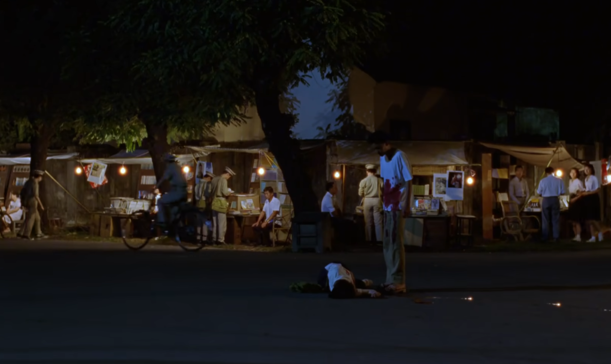
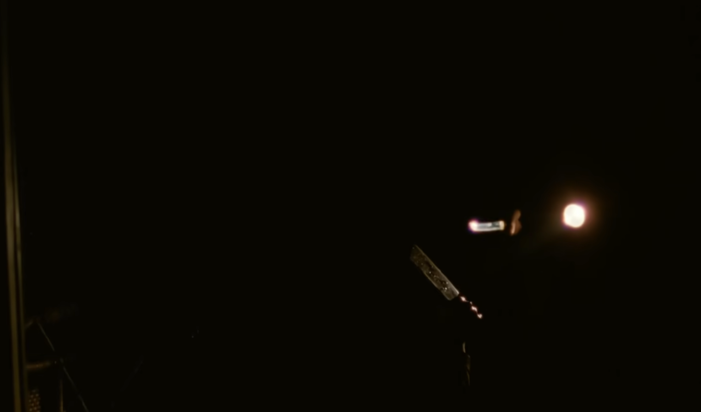
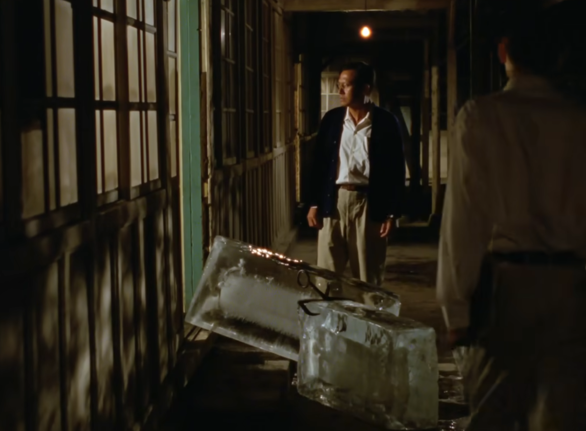
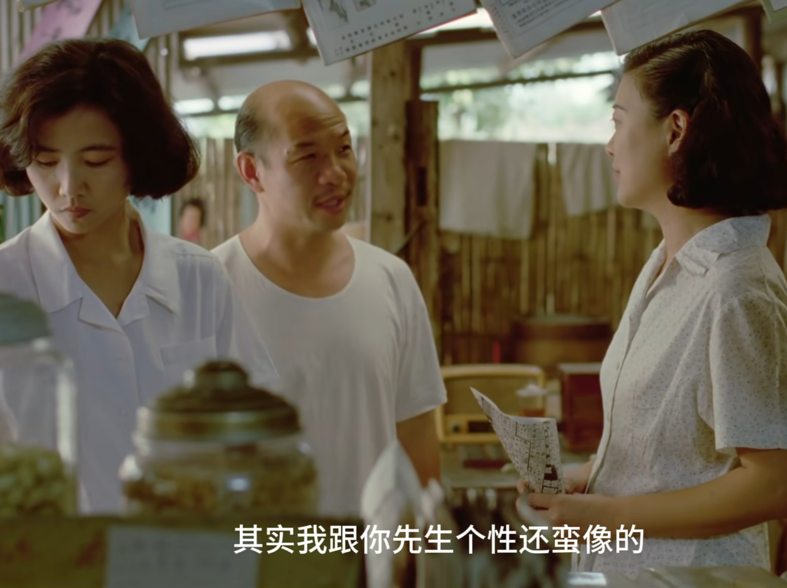

>“妈的，我还真想写本小说咧！给以后像我这种人看。太晚了。书又读得不够多。”

在某些事发生的当时，我就能意识到这是一个life-changing moment。我很情愿这种事不发生。

因为这样那样的原因，我不得不再观看这部电影，再写下这些文字。小明倒在血泊中的场面，不分场合地在我脑海浮现；我老是觉得我是小四。当醒来时，理智不断告诫我不该同情杀人者；那是一种罪。

有人评价这部电影，是“弱者给弱者的一刀”，小四恐怕从没觉得自己是弱者。大家试图教他做一个低头者，但是他失败了。

小马想让小四在友情上低头；小明拒绝臣服小四的占有欲；三姐则是用宗教。改变别人的尝试无一例外失败；改变自己的归信之路(Conversion)，小四差一点走上。哪个都无法改变，只好毁灭其中之一。

从阶级上看，小马是司令的儿子；小四的父母从上海迁台，虽无富贵，也只是于脸面难为情；而小明只是普通士兵的眷属，祖籍四川，来到小岛，群居眷村；母女寄人篱下，扫地出门，已是常态。他们都是台北的外来者。

在这部电影中，“小公园”老大哈尼是这群人中唯一会说台语的人，自然得到台南帮派的支持。在他死后，也是台南帮为他复仇；而他的弟弟和小四，一个想挥刀，但砍不中；一个连刀也拿不起。

杨导花了不少笔墨来描绘小四意识和行为之间的鸿沟；一方面，小四的父母都是“体面”的人，而小四的父亲又是读书人中最正直的那一类。小四的爸爸能在小四被批评退学时站在儿子这一边；大姐想要留学，母亲也是全力支持；如果正常生活，这应该是一个不乏摩擦但极幸福的家庭。然而这一切在小四父亲被审问之后破裂。

读书人，最怕的恐怕不是穷，不是苦，而是和“没读过书的人一样”。最明显的对照就是胖叔（杂货店老板）对小四一家人态度的转变：里面有对小四救他一命的感激；有对小四父亲丢掉工作后的幸灾乐祸，“你也和我一样了”；另外就是小四的父亲需要工作，对他有了利用价值。

我们总嘲笑孔乙己，对于所谓的读书人，脱下长衫是很难的；孔乙己只是某种筛选体制塑造的价值观下的失败品。而这种价值观无时无刻不影响着我们。读书总跟某种世俗的成功相关联，而滑头、不老实，明面被贬低，暗地里是不可多得的能力。更可悲的是，正直的人最后要去讨好能耍滑头的人以换取某种利益，而这本来是违背原本的“正直”之道的。

多年之前我看过张承志的一篇散文：《清洁的精神》。不难知道过于执着于这种“洁”的后果是什么。为了稳定，完全的黑白最后不复存在，但这并不代表某种必经的腐化过程不值得惋惜。

《牯岭街少年杀人事件》于1991年上映，事件原型发生于1961年，但其中所描绘的社会景象，还要再晚些。猫王的回信中，台湾还是一个“不知名的小岛”；之间三十年，经过十大建设的台北，已有成为世界中心的野心。而91年，也正好是49年开始的白色恐怖被正式废止的时间点。

