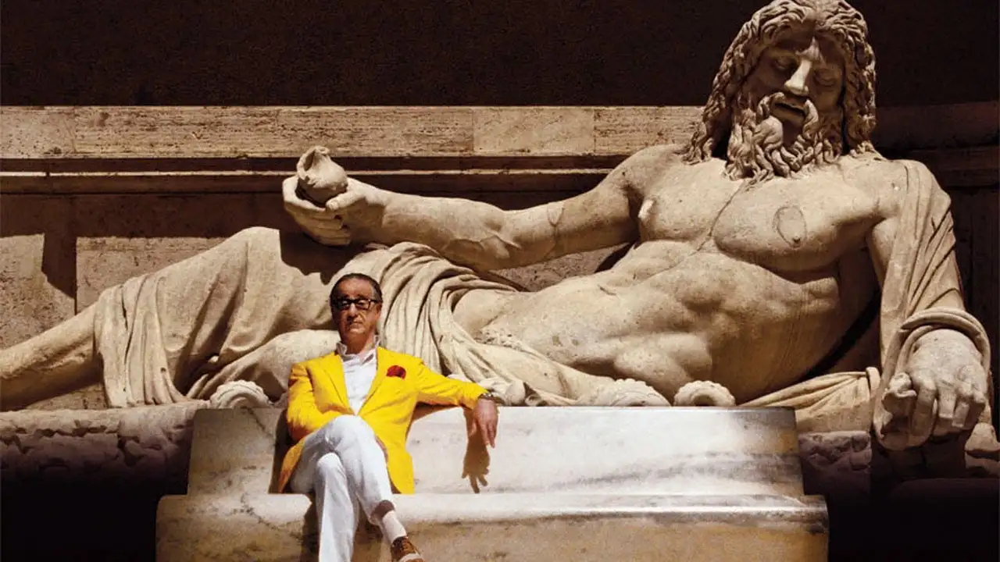
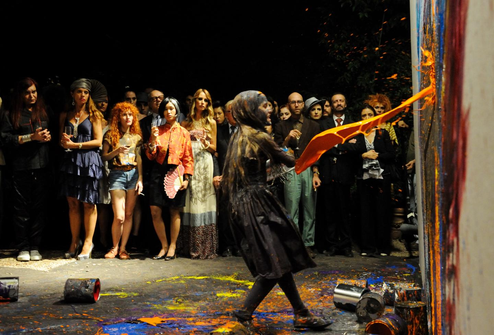
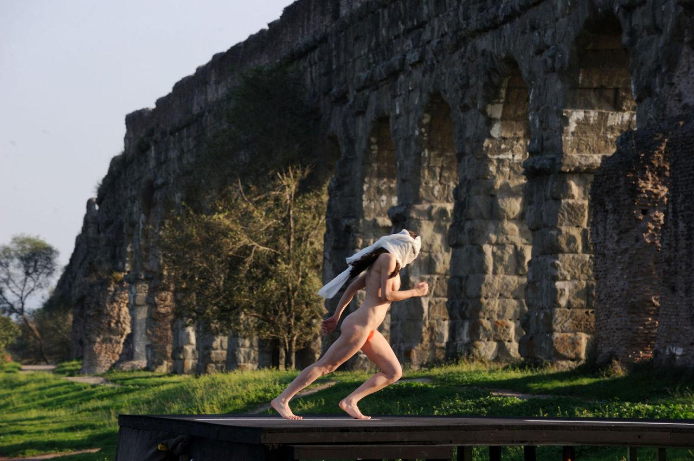
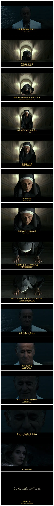

电影社常规放映选片。很让我失望的一部。意大利电影极具盛名，而我从这部开始未尝不是个好选择；不会比这更差了。

溢出屏幕的浮夸。不明所以的叙事。糟糕透顶的主题。艺术上的加入都显得过于刻意而无内涵。而这恰好切中该片的主题。

初中时我去过罗马。斗兽场是上流人的下流消遣，千年过去，浮躁糜烂的气息仍未能从这个城市散去。人们在追求艺术是因为想变得高雅。有人意识到艺术在于肉体，而这只会让精神感到无能为力。

最后以诗结尾。

我一直不清楚结束一部电影的最坏方式是什么。看完这部电影，我恍然大悟，把一切归结为宗教，书也好，电影也好，就无可挽回的毁掉了。从比萨斜塔上抛下一个铅球，试图用一块玻璃————或者是纯粹的空气来接住，尤其做这个实验的还是科学家。这是不可理喻的。